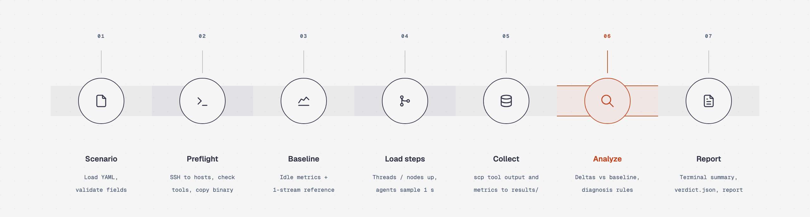

# Data Center Network Workloads

`netbench` is a Linux utility. It runs data center workloads on a black-box network, collects host and
network metrics in parallel, and reports whether the network is the bottleneck. If it is, the report names
the network problem behind the drop: loss, latency, errors or link congestion.

## Team

| | Name | GitHub | Owns |
|:-:|---|---|---|
|  | Maryna Ohinska | [@mohinska](https://github.com/mohinska) | Workload table · MPI scenarios (MVAPICH, GPCNeT) · analysis and report module |
|  | Nazar Mykhailyshchuk | [@partum55](https://github.com/partum55) | Storage and TCP scenarios (fio, iperf3) · scenario runner · metric collection · failure scenarios |
| | Together | | Test matrix · mixed workloads · result analysis · recommendations |

## Problem

**Context.** A data center runs four classes of workloads at the same time:

| Workload | Main traffic | Needs |
|---|---|---|
| AI/HPC (model training) | East-West, server to server | Bandwidth and low latency |
| Distributed storage (replication) | East-West | Bandwidth |
| Virtual machines | Mixed | Mixed |
| Cloud-native services (clients, BYOD, mobile) | North-South, from outside | Low latency |

**Gap.** Load generators do not report network parameters. When a benchmark result drops, it is unclear
whether CPU or the network is the cause. For example, more threads can lower performance because of the
network, and the benchmark does not show it.

**Goal.** Tell **when** the network is the cause and **what** it is: loss, latency, errors or link congestion.

**Setting.** The network is a **black box**: an already configured virtual network with load run on top.

## Goals

1. **Main:** a utility that runs workloads, collects host and network metrics at the same time, and tells
   whether the network is the bottleneck and which network problem causes the drop.
2. Workload table: traffic type (East-West / North-South; bandwidth-, latency-oriented or mixed) and
   network requirements.
3. Test matrix (scenarios for the utility): workload, tool, metrics, expected result.
4. Use the utility to study how workloads affect each other when run together.
5. Test on the topology and recommend test priorities.

## How the utility works



| # | Stage | What happens |
|:-:|---|---|
| 1 | Scenario | Load the YAML scenario from the test matrix, validate it |
| 2 | Preflight | SSH to every host, check that the tools exist, copy the `netbench` binary |
| 3 | Baseline | Agents record metrics with no load, plus one minimal (1-stream) generator run |
| 4 | Load steps | Step up threads and nodes; agents sample every second; faults are injected on schedule |
| 5 | Collect | `scp` generator output, host metrics and router CPU into `results/<run-id>/` |
| 6 | **Analyze** | Deltas against the baseline → [diagnosis rules](docs/bottleneck-diagnosis.md) → verdict per step and the step where the bottleneck starts |
| 7 | Report | Terminal summary, `verdict.json`, `report.md` with PNG charts |

**Verdict logic.** Performance drops while CPU is not saturated, and latency, loss, SeqErr or retransmits
grow. The utility then names the network as the cause and states the specific symptom. Comparing a path
inside one leaf with a path through the spine locates the layer.

**Report rule.** Every verdict shows the numbers it is based on, compared with the baseline. Rules that
could not be checked are listed as *not checked*, so missing data never looks like the absence of a problem.

**Commands.**

| Command | Where it runs | Does |
|---|---|---|
| `netbench run <scenario.yaml>` | Controller | Stages 1–7 |
| `netbench agent` | Each host | Metric collection (started by `run`) |
| `netbench analyze <results/run-id>` | Anywhere | Stages 6–7 on saved results |

## Test topology


| Property | Value |
|---|---|
| Deployment | [containerlab](https://containerlab.dev): FRR routers, BGP, ECMP over both spines |
| Nodes | 2 spine · 2 leaf · 6 hosts (3 per leaf) · controller |
| Links | 1 Gbit each, shaped with `tc tbf` → 3:2 oversubscription at each leaf |
| Faults | `tc netem` (loss, delay, reorder, corruption), link down, container CPU limits |
| Paths | h1↔h2 stays inside a leaf · h1↔h4 crosses the spine |
| Hypervisor | The Docker host: CPU of the Docker host and of every router is recorded too |

## Scenarios

| Scenario | Shows |
|---|---|
| Throughput | Bandwidth as threads and nodes grow |
| Latency under load | Latency (mean, p99) while bandwidth traffic runs |
| Incast | Many senders → one receiver (h2–h6 → h1) |
| Spine load balancing | ECMP spread across both spines |
| Link / node failure | Drop and recovery time |
| Mixed workloads | AI/HPC + storage + background N-S: isolation, bandwidth sharing under oversubscription, recovery after failure |

Detailed testing covers AI/HPC and distributed storage, the most network-demanding classes. Virtualization
and cloud-native services serve as background traffic.

## Tools and metrics

| Tool | Purpose |
|---|---|
| MVAPICH + OSU Micro-Benchmarks | Latency, bandwidth, all-reduce / all-to-all as an AI/HPC model |
| GPCNeT | Impact of congestion on other traffic |
| iperf3 / netperf | Baseline throughput and latency, TCP/UDP, varying stream count |
| fio over network storage | Storage traffic, incast |
| mpstat, sar, ss, nstat, interface counters, active probes | CPU and network state during a test (collected by the utility) |

**Metrics:** throughput · latency (mean, p99) · Loss · Err · SeqErr · retransmits · CPU utilization.

## Deliverables

- [ ] **Utility (main deliverable):** scenario runner, metric collection, automatic bottleneck detection (network vs CPU, specific network symptom), with docs
- [ ] Workload table
- [ ] Test matrix
- [ ] Test results: utility reports for single and mixed workloads on the test topology
- [ ] Prioritized test recommendations (documented facts separated from assumptions)

## Limitations

| Limitation | Effect | How it is handled |
|---|---|---|
| Virtual network ≠ physical hardware (switch buffers, RDMA) | Absolute values differ from real hardware | Compare behavior, not absolute values |
| No RDMA hardware in containers | MVAPICH runs over TCP (libfabric `tcp`), not its RDMA fast path | RDMA via Soft-RoCE is in the backlog |
| Hosts and routers share the same physical CPU | A "network" and a "CPU" bottleneck can be the same thing | Router and Docker host CPU are recorded; such verdicts are flagged |
| Network configuration is treated as unknown | The problem layer cannot be read directly | Inferred from in-leaf vs through-spine path comparison |

## Tech

| | |
|---|---|
| Language | Go, one binary `netbench` (Linux only) |
| Platform | Linux; on macOS the utility and topology run in a Linux VM (OrbStack / Docker Desktop) |
| Build and test | `make build` · `make test` |
| Libraries | Go stdlib · `gopkg.in/yaml.v3` · `gonum` (statistics, `gonum/plot` charts) · system `ssh` / `scp` |

## Project structure

```
cmd/netbench/         # entry point: netbench run | agent | analyze
internal/scenario/    # scenario YAML and results/ data contract
internal/runner/      # scenario runner (iperf3, OSU, GPCNeT, fio), stepping threads and nodes
internal/collect/     # metric collection: mpstat, sar, ss, nstat, interface counters, probes
internal/analyze/     # baseline comparison, diagnosis rules, verdict, report
scenarios/            # YAML scenarios from the test matrix
testbed/              # containerlab topology, link profiles (tc), host images
docs/                 # proposal, diagnosis rules, workload table, test matrix, results
docs/diagrams/        # diagram sources (HTML) → docs/img/ (PNG)
tasks/                # implementation plan and task list
results/              # measurement output (gitignored)
```

## Documentation

| Document | Contents |
|---|---|
| [docs/proposal.md](docs/proposal.md) | Project proposal (UA) |
| [docs/bottleneck-diagnosis.md](docs/bottleneck-diagnosis.md) | Bottleneck diagnosis rules |
| [tasks/plan.md](tasks/plan.md) | Implementation plan: architecture, phases, risks |
| [tasks/todo.md](tasks/todo.md) | Task list with acceptance criteria |
