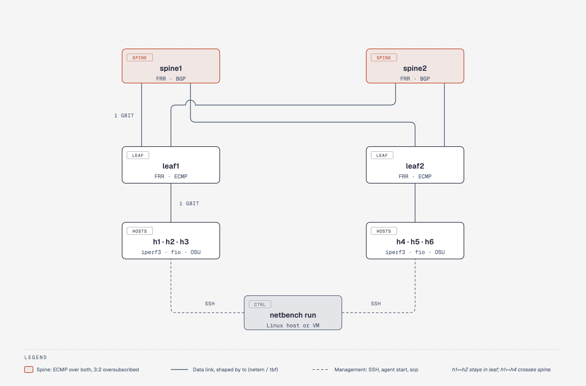

# Data Center Network Workloads

This project describes the **traffic profiles** of data center workloads, backend and frontend, and picks
test tools from those profiles. The main deliverable is the description: [docs/traffic-profiles.md](docs/traffic-profiles.md).

`netbench` is a proof-of-concept Linux utility on top of it. It runs a workload with a given profile on a
black-box network, collects host and network metrics in parallel, and reports whether the network is the
bottleneck. If it is, the report names the network problem behind the drop: loss, latency, errors or link
congestion.

## Team

| | Name | GitHub | Owns |
|:-:|---|---|---|
|  | Maryna Ohinska | [@mohinska](https://github.com/mohinska) | Traffic profile description (lead) · tool × profile matrix · test matrix · PoC analysis and report module · OSU/MPI scenarios · utility documentation |
|  | Nazar Mykhailyshchuk | [@partum55](https://github.com/partum55) | Most of the PoC code, the part needed first: testbed · scenario runner (iperf3, netperf) · metric collection · diagnosis rules · stepped load and profile shape · frontend profile sections, checks the tool matrix by running the tools |
| | Together | | Profile dimensions and definitions · data contract · mixed workloads · calibration and runs · recommendations |

## Problem

**Context.** A data center runs several classes of workloads at the same time. Their traffic differs a lot:

| | Backend fabric (AI training, HPC) | Frontend fabric (clients, Internet, cloud-native, storage) |
|---|---|---|
| Pairs | Few, fixed paths between predefined nodes | Very many addresses, chaotic |
| Shape in time | Either silence or 100 % of the link | Fairly even load with spikes, changes with time of day |
| Loss | A few lost packets are a catastrophe | Sensitive in most cases, with some exceptions |

Which tool to run and which metrics matter depends on the profile, not on the workload name.

**Gap.** There is no formal description of these profiles to choose tools from. Load generators also do not
report network parameters: when a benchmark result drops, it is unclear whether CPU or the network is the
cause.

**Setting.** The network is a **black box**: an already configured virtual network with load run on top.

## Goals

1. **Main:** describe the traffic profiles of backend and frontend in a cluster: definitions, dimensions,
   what they depend on, workloads grouped by profile → [docs/traffic-profiles.md](docs/traffic-profiles.md).
2. For each profile: tools that can generate it, and what each tool does and does not reproduce.
3. Test matrix: profile, tool, metrics, expected result.
4. **PoC utility** (`netbench`): runs a profile, collects host and network metrics, tells whether the network
   is the bottleneck and which problem causes the drop.
5. Test the PoC on the topology and recommend test priorities.

## Traffic profiles

**Backend** and **frontend** name the *fabric*; East-West / North-South is a separate dimension.

| | Backend | Frontend |
|---|---|---|
| Connects | Compute nodes / GPUs with each other | Clients and Internet with services, services with each other, nodes with storage |
| Traffic | One job's internal exchange: training collectives, MPI | North-South, plus East-West: microservice fan-out, data loading, checkpoints, management |

Storage (including replication) rides the frontend or a separate storage network, not the backend.

Profile dimensions: direction · src/dst pairs · shape in time · flow size · synchronization and pattern ·
loss sensitivity · latency sensitivity · transport · ECMP entropy. Each dimension has categories and a
measurable indicator. The table of profiles, the dimension → factor → mechanism mapping and the tool × profile
matrix are in [docs/traffic-profiles.md](docs/traffic-profiles.md) (draft).

## PoC scope

The utility only needs to show the approach, so the PoC stays narrow: iperf3 and OSU, two profiles (AI-like
backend: synchronous collectives, on-off; multi-stream frontend-like), the first diagnosis rules. What the
testbed cannot reproduce (RDMA, lossless fabric, real switch buffers) is listed in the profiles document.
The rest of the rules and scenarios are in the backlog in [tasks/todo.md](tasks/todo.md).

## How the PoC utility works


| # | Stage | What happens |
|:-:|---|---|
| 1 | Scenario | Load the YAML scenario from the test matrix, validate it |
| 2 | Preflight | SSH to every host, check that the tools exist, copy the `netbench` binary |
| 3 | Baseline | Agents record metrics with no load, plus one minimal (1-stream) generator run |
| 4 | Load steps | Step up threads and nodes; agents sample every second; faults are injected on schedule |
| 5 | Collect | `scp` generator output, host metrics and router CPU into `results/<run-id>/` |
| 6 | **Analyze** | Deltas against the baseline → [diagnosis rules](docs/bottleneck-diagnosis.md) → verdict per step and the step where the bottleneck starts |
| 7 | Report | Terminal summary, `verdict.json`, `report.md` with PNG charts |

**Verdict logic.** Performance drops while CPU is not saturated, and latency, loss, SeqErr or retransmits
grow. The utility then names the network as the cause and states the specific symptom. Comparing a path
inside one leaf with a path through the spine locates the layer.

**Report rule.** Every verdict shows the numbers it is based on, compared with the baseline. Rules that
could not be checked are listed as *not checked*, so missing data never looks like the absence of a problem.

**Commands.**

| Command | Where it runs | Does |
|---|---|---|
| `netbench run <scenario.yaml>` | Controller | Stages 1–7 |
| `netbench agent` | Each host | Metric collection (started by `run`) |
| `netbench analyze <results/run-id>` | Anywhere | Stages 6–7 on saved results |

## Test topology



| Property | Value |
|---|---|
| Deployment | [containerlab](https://containerlab.dev): FRR routers, BGP, ECMP over both spines |
| Nodes | 2 spine · 2 leaf · 6 hosts (3 per leaf) · controller |
| Links | 1 Gbit each, shaped with `tc tbf` → 3:2 oversubscription at each leaf |
| Faults | `tc netem` (loss, delay, reorder, corruption), link down, container CPU limits |
| Paths | h1↔h2 stays inside a leaf · h1↔h4 crosses the spine |
| Hypervisor | The Docker host: CPU of the Docker host and of every router is recorded too |

## Scenarios

| Scenario | Shows | PoC |
|---|---|:-:|
| Throughput | Bandwidth as threads and nodes grow | ✓ |
| Latency under load | Latency (mean, p99) while bandwidth traffic runs | ✓ |
| Incast | Many senders → one receiver (h2–h6 → h1) | backlog |
| Spine load balancing | ECMP spread across both spines | backlog |
| Link / node failure | Drop and recovery time | backlog |
| Mixed workloads | One backend-like + one frontend-like profile together: isolation, bandwidth sharing under oversubscription | minimal |

## Tools and metrics

Tools are chosen from the profiles: which dimensions each tool reproduces is in the tool × profile matrix in
[docs/traffic-profiles.md](docs/traffic-profiles.md#5-профіль--інструмент). The PoC uses:

| Tool | Profile it models | PoC |
|---|---|:-:|
| MVAPICH + OSU Micro-Benchmarks | AI/HPC backend: fixed pairs, synchronous all-reduce / all-to-all, on-off | ✓ |
| iperf3 / netperf | Frontend-like: many streams, baseline throughput and latency, TCP/UDP | ✓ |
| GPCNeT | Impact of congestion on other traffic | backlog |
| fio over network storage | Storage traffic, incast | backlog |
| mpstat, sar, ss, nstat, interface counters, active probes | CPU and network state during a test (collected by the utility) |

**Metrics:** throughput · latency (mean, p99) · Loss · Err · SeqErr · retransmits · CPU utilization.

## Deliverables

- [ ] **Traffic profile description (main deliverable):** definitions, dimensions, dependencies, table of profiles, tool × profile matrix, sources
- [ ] Test matrix (from the profiles)
- [ ] **PoC utility:** scenario runner, metric collection, bottleneck detection (network vs CPU, specific network symptom), with docs
- [ ] Test results: PoC reports for single and mixed profiles on the test topology
- [ ] Prioritized test recommendations (documented facts separated from assumptions)

## Limitations

| Limitation | Effect | How it is handled |
|---|---|---|
| Virtual network ≠ physical hardware (switch buffers, RDMA) | Absolute values differ from real hardware | Compare behavior, not absolute values |
| No RDMA hardware in containers | MVAPICH runs over TCP (libfabric `tcp`), not its RDMA fast path; the AI backend profile is reproduced by traffic shape, not by transport | RDMA via Soft-RoCE is in the backlog |
| Only 6 hosts | Many streams can be reproduced, many distinct addresses cannot | Stated in the profiles document |
| Hosts and routers share the same physical CPU | A "network" and a "CPU" bottleneck can be the same thing | Router and Docker host CPU are recorded; such verdicts are flagged |
| Network configuration is treated as unknown | The problem layer cannot be read directly | Inferred from in-leaf vs through-spine path comparison |

## Tech

| | |
|---|---|
| Language | Go, one binary `netbench` (Linux only) |
| Platform | Linux; on macOS the utility and topology run in a Linux VM (OrbStack / Docker Desktop) |
| Build and test | `make build` · `make test` |
| Libraries | Go stdlib · `gopkg.in/yaml.v3` · `gonum` (statistics, `gonum/plot` charts) · system `ssh` / `scp` |

## Project structure

```
cmd/netbench/         # entry point: netbench run | agent | analyze
internal/scenario/    # scenario YAML and results/ data contract
internal/runner/      # scenario runner (iperf3, OSU, GPCNeT, fio), stepping threads and nodes
internal/collect/     # metric collection: mpstat, sar, ss, nstat, interface counters, probes
internal/analyze/     # baseline comparison, diagnosis rules, verdict, report
scenarios/            # YAML scenarios from the test matrix
testbed/              # containerlab topology, link profiles (tc), host images
docs/                 # traffic profiles, proposal, diagnosis rules, test matrix, results
docs/diagrams/        # diagram sources (HTML) → docs/img/ (PNG)
tasks/                # implementation plan and task list
results/              # measurement output (gitignored)
```

## Documentation

| Document | Contents |
|---|---|
| [docs/traffic-profiles.md](docs/traffic-profiles.md) | **Traffic profiles: backend vs frontend (main deliverable, draft, UA)** |
| [docs/proposal.md](docs/proposal.md) | Project proposal (UA) |
| [docs/bottleneck-diagnosis.md](docs/bottleneck-diagnosis.md) | Bottleneck diagnosis rules (PoC) |
| [tasks/plan.md](tasks/plan.md) | Implementation plan: architecture, phases, risks |
| [tasks/todo.md](tasks/todo.md) | Task list with acceptance criteria |
